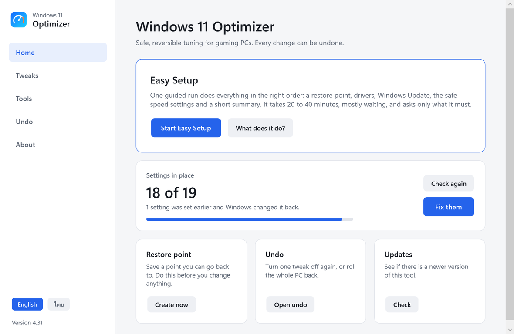
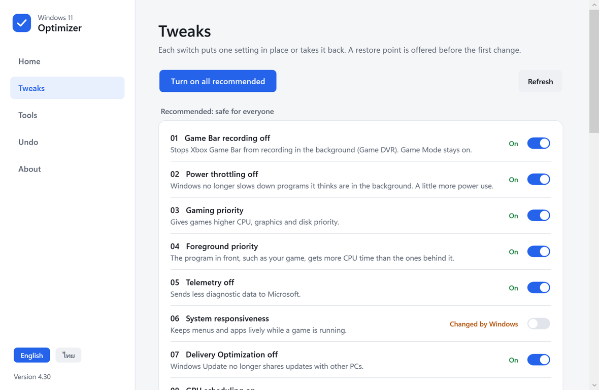
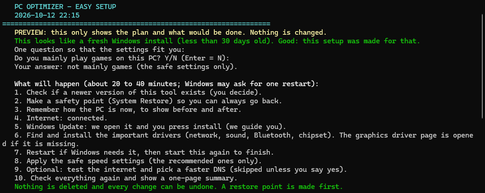
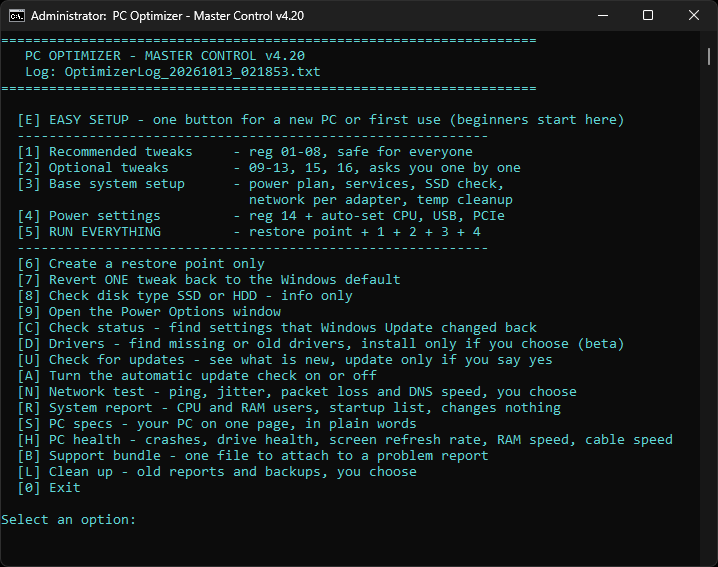
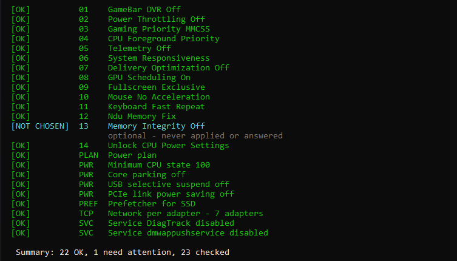
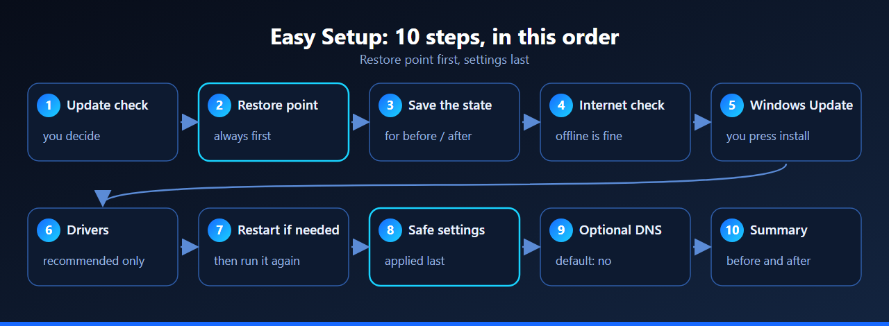

  

  
  
  
  
  

<b>English</b> &nbsp;|&nbsp; <a href="README.th.md">ภาษาไทย</a>

**win11-optimizer** tunes a Windows 11 gaming PC with small, documented changes. A restore point comes first. Every tweak is a readable `.reg` file with its own undo file, and one button (**Easy Setup**) runs the whole job in the right order.

  

## Start in 3 steps

1. **Download** the ZIP with the green button above. You do not need a GitHub account. Right-click the ZIP, choose **Extract All**, and open the new folder. Do not run files from inside the ZIP.
2. **Open `Win11 Optimizer.exe`** (Windows asks for administrator rights once) and press **Start Easy Setup**. You prefer the keyboard? Double-click `0_Easy_Setup (Run as Administrator).bat` instead (right-click, then **Run as administrator**).
3. **Answer one question** (do you mainly play games?), and read the plan. Press **Y** to start. Restart when it asks, then start Easy Setup again and it continues.

> [!NOTE]
> Windows SmartScreen or your antivirus may warn about `.bat` files that change settings. That is normal for this kind of tool. Read the scripts first, they are plain text. Right-click the ZIP, open **Properties**, tick **Unblock** and press OK before you extract it to avoid a warning for every file. Never turn your antivirus off for this tool.

## The window

`Win11 Optimizer.exe` is a normal Windows program with nothing to install. It sits next to the folders of the tool and lets you click instead of typing: **Easy Setup**, one switch per tweak with its status, every tool, and the undo options. It follows light or dark mode and speaks **English or Thai** (switch in the side bar). It only starts the scripts of this repository, so everything below still applies.

<table>
  <tr>
    <td width="50%"></td>
    <td width="50%"></td>
  </tr>
  <tr>
    <td align="center">Home: Easy Setup and the state of your settings</td>
    <td align="center">Tweaks: one switch each, with an undo</td>
  </tr>
</table>

> [!NOTE]
> The program is not code-signed, so SmartScreen may say "Windows protected your PC": click **More info**, then **Run anyway**, or use the `.bat` files, which do the same. The source is in [`app/`](app/) (about 1,500 lines of C#). `powershell -File app\build.ps1` builds it with the compiler that ships with Windows, so you can check that the exe matches.

## What it looks like

<table>
  <tr>
    <td width="34%"></td>
    <td width="33%"></td>
    <td width="33%"></td>
  </tr>
  <tr>
    <td align="center">Easy Setup shows its plan first</td>
    <td align="center">Main menu</td>
    <td align="center">Check Status after a Windows update</td>
  </tr>
</table>

## Why you can trust it

- **Safe first.** A restore point is made before any change. `2_Revert_Everything` rolls back with System Restore, and menu `7` undoes one tweak at a time.
- **Open and readable.** Every tweak is a plain `.reg` file. Automated tests run on a clean Windows machine for every change to this repository.
- **Guided.** Easy Setup handles the order: restore point, Windows Update (you press install), drivers, safe settings, then a before and after summary. It stops safely when something is missing and continues after a restart.
- **Honest.** The gains are small and depend on the game. GPU driver settings, in-game settings, XMP/EXPO and cooling matter far more. The manual marks every tweak without official Microsoft documentation as community-sourced.

## What it does and does not do

| It does | It does not |
|---|---|
| Create a restore point before it changes anything | Delete your files or games |
| Apply 26 documented registry, power and network tweaks, each with an undo file | Edit game files, inject into games or add overlays |
| Install recommended drivers from Windows Update (never a maker's graphics driver or firmware) | Install third-party programs or "driver updater" tools |
| Show your PC specs, health and crashes in plain words | Promise FPS numbers |
| Measure your PC at rest before and after the tweaks, list the programs that start with Windows and switch one off, show what temporary files take and remove them only when you say yes | Hide a result: the measurement says plainly when nothing changed. It never removes anything without asking |
| Update itself after you say yes, with a SHA-256 check | Send your data anywhere. It contacts github.com for updates and Microsoft for drivers |

## How Easy Setup works

Settings come last on purpose: updates and drivers can change settings. With no internet, the online steps are skipped and the rest still runs. On a laptop, tweaks that raise heat and battery use are skipped.

<b>Updating</b>

Press `U` in the main menu, or run `More Tools\6_Check_For_Updates`. It shows what is new and installs the update **only if you say yes**. The download is checked against a SHA-256 checksum. The old version is saved to `Backup\update_<old>_<time>` and put back automatically if anything fails. Your Backup folder, logs and reports are never touched. The menu asks once whether it may check automatically when it opens (press `A` to change that later). Going from v4.5 or older to v4.6 or newer needs one manual download. After that the tool updates itself.

<b>Folder layout</b>

The main folder holds only three files to double-click (0, 1 and 2). Everything else is in `More Tools/`, and every tool also starts from the main menu (1).

| Path | Purpose |
|---|---|
| `docs/` | Manuals (PDF, English and Thai; the programs themselves print English): run order, what each `.reg` does, manual Windows settings, references. Also the NVIDIA driver settings guide (`GPU_Driver_Guide_EN.pdf` and `_TH.pdf`). HTML sources are in `docs/src/` |
| `0_Easy_Setup ... .bat` | One button for a new Windows install and for beginners |
| `1_Start_Here ... .bat` | Main menu |
| `2_Revert_Everything ... .bat` | Restore to the `Before_PC_Optimizer` restore point |
| `More Tools/3_Check_Status ... .bat` | Check which tweaks are still applied |
| `More Tools/4_Network_Test.bat` | Ping, jitter, packet loss and DNS speed. Changes nothing unless you pick a DNS at the end |
| `More Tools/5_System_Report.bat` | Read-only report of CPU and RAM users, startup programs, disk space and GPU driver age (no admin needed) |
| `More Tools/6_Check_For_Updates.bat` | Looks for a newer version and updates only if you say yes (no admin needed) |
| `More Tools/7_Driver_Check ... .bat` | BETA. Finds devices with no driver and Windows Update driver updates, installs only if you choose. Menu choice C cleans old driver versions |
| `More Tools/S_PC_Specs.bat` | Your PC on one page in plain words. No serial numbers or addresses, so you can share it (no admin needed) |
| `More Tools/8_PC_Health.bat` | Read-only health check: blue screens and crashes, drive health, battery wear, refresh rate, RAM speed, network cable speed (no admin needed) |
| `More Tools/9_Support_Bundle.bat` | Puts the version, reports and logs into one file for a problem report. Private details are replaced and nothing is sent (no admin needed) |
| `More Tools/L_Clean_Up.bat` | Shows old reports and backups and removes them only when you choose (no admin needed) |
| `Logs/` | Created when you run a tool: every log and report. The newest 3 of each kind are kept |
| `reg/` | Tweaks: `1_Recommended` (01-08), `2_Optional` (09-13, 15, 18-20, 23-26), `3_Power` (14) |
| `reg_undo/` | One undo file per tweak (Windows defaults) |
| `tools/` | PowerShell helpers used by the menu (keep this folder) |
| `repair-tools/` | Deep clean, network reset, Bluetooth fix, DISM and SFC |

<b>Main menu keys</b>

`E` Easy Setup, `1` Recommended, `2` Optional 09-13, 15, 16, 18-27 (one by one), `3` Base setup (power plan, services, SSD/HDD check, temp cleanup), `4` Power settings, `5` Everything, `6` Restore point only, `7` Revert one tweak, `8` Disk type, `9` Power Options, `C` Check status, `D` Drivers (beta), `U` Check for updates, `A` Automatic update check on or off, `N` Network test, `R` System report, `S` PC specs, `H` PC health, `B` Support bundle, `L` Clean up old reports and backups, `M` Measure before and after, `F` Free up disk space, `P` Startup programs, `W` Check after Windows Update.

<b>Check that the download is genuine</b>

- Every release has a `win11-optimizer.zip.sha256` file. In PowerShell, `(Get-FileHash .\win11-optimizer.zip -Algorithm SHA256).Hash` gives the checksum of your download; it must be the same text as in that file. The updater (menu `U`) makes this check by itself before it installs anything.
- You do not have to trust the program file. The sources are in [`app/`](app/), and `powershell -File app\build.ps1` builds `Win11 Optimizer.exe` with the compiler that ships with Windows (nothing to download). The `.bat` and `.ps1` files are plain text that you can read.
- The program is not code-signed, so SmartScreen may warn, and some antivirus programs flag any tool that changes system settings. If yours complains, read what it says. Do not turn it off.

<b>Manuals and guides</b>

- Manual: [English](docs/Manual_EN_v4.33.pdf) | [ภาษาไทย](docs/Manual_TH_v4.33.pdf)
- NVIDIA driver settings, step by step with screenshots (driver 582.78, GTX 1070): [English](docs/GPU_Driver_Guide_EN.pdf) | [ภาษาไทย](docs/GPU_Driver_Guide_TH.pdf)
- [Changelog](CHANGELOG.md)

The programs print English only. The Thai manual explains every message.

<b>Requirements</b>

Windows 11 (build 22000 or newer) and administrator rights. The tool targets desktops. On a laptop the menu advises against tweaks 02 and 16, and on older Windows it warns first.

<b>Questions and answers</b>

**Will it raise my FPS?** Slightly, and only in some games. Treat any promise of big gains from software tweaks with suspicion. Start with your GPU driver settings and in-game settings.

**What does Maximum do?** If you say you mainly play games, Easy Setup asks a second question. Maximum applies every optional tweak in one go: fullscreen exclusive (09), mouse (10), keyboard (11), Ndu fix (12), timer (15), CPU boost (16), drivers only from you (18), startup programs at once (19), quick menus (20), windowed-game optimization (21), network adapters stay on (22), Game Mode (23), End task in the taskbar (24), background apps (25), Edge in the background (26) and hibernation (27). Turning Memory Integrity off (13) needs its own typed YES because it lowers protection. On a laptop, timer, CPU boost, the network adapter setting and hibernation are skipped. Main menu `5` still lets you choose each tweak yourself.

**Can I undo everything?** Yes. `2_Revert_Everything` returns the whole PC to the `Before_PC_Optimizer` restore point. Menu `7` reverts one tweak. The `reg_undo` folder holds one undo file per tweak.

**Does it touch my games or anti-cheat?** No. It changes Windows settings only: it does not edit game files, inject code or add overlays. Anti-cheat rules belong to each publisher, so check yours. The PC specs page shows Secure Boot and TPM status, which some games require on Windows 11.

**What does it send over the internet?** The update check contacts github.com and sends nothing about you. Driver search uses Windows Update. The network test pings public DNS servers when you start it. Logs stay in the `Logs` folder, and the support bundle replaces private details and is never sent.

**How do I remove it?** There is no installer. Run `2_Revert_Everything` or undo tweaks from menu `7`, then delete the folder.

**Notice for v4.6 or older.** The old `repair-tools\Deep_Clean_Junk_Files.bat` selected the Disk Cleanup categories Downloads and Recycle Bin, which can delete files you want to keep. Update to v4.7 or later and check your Downloads folder.

## Problems or ideas

Open an [issue](https://github.com/Kensukeimagery/win11-optimizer/issues/new/choose). The form asks for your version and Windows build and lists which log files to attach. Check them for anything private first. To report a security problem, read [SECURITY.md](SECURITY.md).

## License

[MIT](LICENSE)
