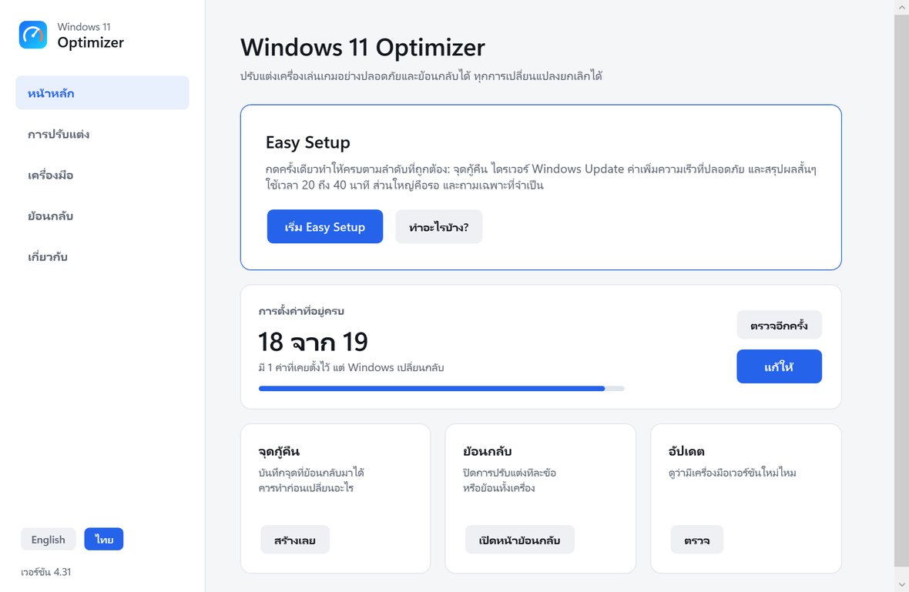
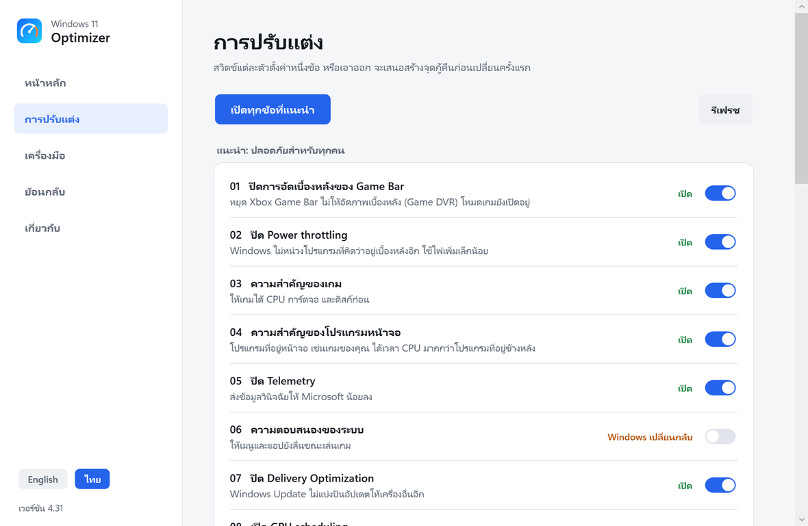
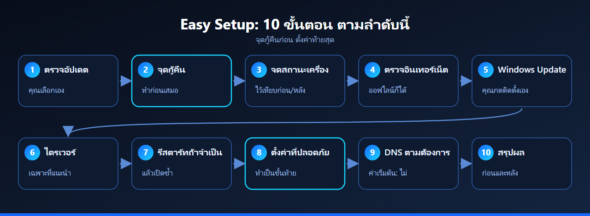

  

  
  
  
  
  

<a href="README.md">English</a> &nbsp;|&nbsp; <b>ภาษาไทย</b>

**win11-optimizer** ปรับ Windows 11 สำหรับเครื่องเล่นเกมด้วยการเปลี่ยนแปลงเล็กๆ ที่มีเอกสารรองรับ โปรแกรมสร้างจุดกู้คืนก่อนเสมอ ทุกการตั้งค่าเป็นไฟล์ `.reg` ที่เปิดอ่านได้และมีไฟล์ย้อนกลับของตัวเอง และปุ่มเดียว (**Easy Setup**) ทำทุกอย่างตามลำดับที่เหมาะสม

  

## เริ่มใน 3 ขั้นตอน

1. **ดาวน์โหลด** ไฟล์ ZIP ด้วยปุ่มสีเขียวด้านบน ไม่ต้องมีบัญชี GitHub คลิกขวาที่ ZIP เลือก **Extract All** แล้วเปิดโฟลเดอร์ที่แตกออกมา อย่ารันไฟล์จากในไฟล์ ZIP
2. **เปิด `Win11 Optimizer.exe`** (Windows จะขอสิทธิ์ผู้ดูแลระบบหนึ่งครั้ง) แล้วกด **Start Easy Setup** ถ้าชอบแบบเดิม ดับเบิลคลิก `0_Easy_Setup (Run as Administrator).bat` แทนก็ได้ (คลิกขวาแล้วเลือก **Run as administrator**)
3. **ตอบหนึ่งคำถาม** (คุณเล่นเกมเป็นหลักไหม) อ่านแผน แล้วกด **Y** เพื่อเริ่ม ถ้าโปรแกรมขอรีสตาร์ท ให้รีสตาร์ทแล้วเริ่ม Easy Setup อีกครั้ง โปรแกรมจะทำต่อ

> [!NOTE]
> Windows SmartScreen หรือแอนตี้ไวรัสอาจเตือนไฟล์ `.bat` ที่เปลี่ยนการตั้งค่า เป็นเรื่องปกติของเครื่องมือประเภทนี้ เปิดอ่านสคริปต์ก่อนได้ เพราะเป็นข้อความธรรมดา คลิกขวาที่ไฟล์ ZIP เลือก **Properties** ติ๊ก **Unblock** แล้วกด OK ก่อนแตกไฟล์ จะไม่เตือนทุกไฟล์ และอย่าปิดแอนตี้ไวรัสเพื่อใช้เครื่องมือนี้

## หน้าต่างโปรแกรม

`Win11 Optimizer.exe` เป็นโปรแกรม Windows ธรรมดา ไม่ต้องติดตั้ง วางอยู่ข้างโฟลเดอร์ของเครื่องมือ ใช้เมาส์คลิกแทนการพิมพ์ได้เลย: **Easy Setup**, สวิตช์ต่อการปรับแต่งแต่ละข้อพร้อมสถานะ, เครื่องมือทุกตัว และตัวเลือกย้อนกลับ ตามโหมดสว่างหรือมืดของ Windows และใช้ได้ทั้ง **ภาษาไทยและภาษาอังกฤษ** (สวิตช์ที่แถบด้านซ้าย) โปรแกรมแค่สั่งสคริปต์ของ repo นี้ ทุกอย่างที่เขียนไว้ด้านล่างจึงยังใช้ได้เหมือนเดิม

<table>
  <tr>
    <td width="50%"></td>
    <td width="50%"></td>
  </tr>
  <tr>
    <td align="center">หน้าหลัก: Easy Setup และสถานะการตั้งค่า</td>
    <td align="center">การปรับแต่ง: สวิตช์ทีละข้อ ย้อนกลับได้</td>
  </tr>
</table>

> [!NOTE]
> โปรแกรมยังไม่ได้ลงลายเซ็นดิจิทัล SmartScreen อาจขึ้นว่า "Windows protected your PC" กด **More info** แล้ว **Run anyway** หรือใช้ไฟล์ `.bat` ซึ่งทำงานเหมือนกัน ซอร์สโค้ดอยู่ที่ [`app/`](app/) (C# ราว 1,500 บรรทัด) คำสั่ง `powershell -File app\build.ps1` คอมไพล์ด้วยคอมไพเลอร์ที่มากับ Windows จึงตรวจได้ว่า exe ตรงกับซอร์ส

## หน้าตาของโปรแกรม

<table>
  <tr>
    <td width="34%"></td>
    <td width="33%"></td>
    <td width="33%"></td>
  </tr>
  <tr>
    <td align="center">Easy Setup แสดงแผนก่อนเริ่ม</td>
    <td align="center">เมนูหลัก</td>
    <td align="center">Check Status หลังอัปเดต Windows</td>
  </tr>
</table>

## ทำไมถึงไว้ใจได้

- **ปลอดภัยก่อน** สร้างจุดกู้คืนก่อนเปลี่ยนอะไรเสมอ `2_Revert_Everything` ย้อนทั้งเครื่องด้วย System Restore และเมนู `7` ย้อนทีละค่า
- **เปิดและอ่านได้** ทุกค่าเป็นไฟล์ `.reg` ธรรมดา ทุกครั้งที่แก้โปรเจกต์นี้ มีการทดสอบอัตโนมัติบนเครื่อง Windows ที่สะอาด
- **มีคนนำทาง** Easy Setup จัดลำดับให้: จุดกู้คืน, Windows Update (คุณกดติดตั้งเอง), ไดรเวอร์, ตั้งค่าที่ปลอดภัย และสรุปก่อนกับหลัง ถ้าขาดอะไรจะหยุดอย่างปลอดภัย และทำต่อได้หลังรีสตาร์ท
- **พูดตามจริง** ผลที่ได้เล็กน้อยและขึ้นกับเกม การตั้งค่าไดรเวอร์การ์ดจอ การตั้งค่าในเกม XMP/EXPO และการระบายความร้อนสำคัญกว่ามาก คู่มือระบุว่ารายการไหนไม่มีเอกสารทางการของ Microsoft (ใช้ข้อมูลจากชุมชน)

## ทำอะไร และไม่ทำอะไร

| ทำ | ไม่ทำ |
|---|---|
| สร้างจุดกู้คืนก่อนเปลี่ยนอะไร | ลบไฟล์หรือเกมของคุณ |
| ปรับ 24 ค่าของ registry พลังงานและเครือข่าย ที่มีเอกสารรองรับ แต่ละค่ามีไฟล์ย้อนกลับ | แก้ไฟล์เกม ฉีดโค้ดเข้าเกม หรือเพิ่มโอเวอร์เลย์ |
| ติดตั้งไดรเวอร์ที่แนะนำจาก Windows Update (ไม่ติดตั้งไดรเวอร์การ์ดจอหรือเฟิร์มแวร์ของผู้ผลิต) | ติดตั้งโปรแกรมของบุคคลที่สามหรือโปรแกรม "อัปเดตไดรเวอร์" |
| แสดงสเปค สุขภาพเครื่อง และประวัติการแครชเป็นภาษาที่เข้าใจง่าย | สัญญาตัวเลข FPS |
| อัปเดตตัวเองหลังคุณตอบตกลง พร้อมตรวจ SHA-256 | ส่งข้อมูลของคุณไปที่ไหน โปรแกรมติดต่อ github.com เพื่อตรวจอัปเดต และติดต่อ Microsoft เพื่อไดรเวอร์ |

## Easy Setup ทำงานอย่างไร

ขั้นตอนตั้งค่าอยู่ท้ายสุดโดยตั้งใจ เพราะการอัปเดตและไดรเวอร์อาจเปลี่ยนค่าได้ ถ้าไม่มีอินเทอร์เน็ต ขั้นตอนออนไลน์จะถูกข้ามและขั้นอื่นยังทำต่อ บนโน้ตบุ๊กจะข้ามค่าที่เพิ่มความร้อนและกินแบตเตอรี่

<b>การอัปเดต</b>

กด `U` ในเมนูหลัก หรือรัน `More Tools\6_Check_For_Updates` โปรแกรมจะแสดงว่ามีอะไรใหม่ และติดตั้ง**เฉพาะเมื่อคุณตอบตกลง** ไฟล์ที่ดาวน์โหลดถูกตรวจกับค่า SHA-256 เวอร์ชันเดิมถูกเก็บไว้ที่ `Backup\update_<เวอร์ชันเดิม>_<เวลา>` และใส่กลับให้อัตโนมัติถ้ามีอะไรผิดพลาด โฟลเดอร์ Backup, log และรายงานของคุณไม่ถูกแตะ เมนูจะถามหนึ่งครั้งว่าให้ตรวจอัตโนมัติตอนเปิดไหม (กด `A` เพื่อเปลี่ยนภายหลัง) การอัปเดตจาก v4.5 หรือเก่ากว่าเป็น v4.6 ขึ้นไปต้องดาวน์โหลดเองหนึ่งครั้ง หลังจากนั้นโปรแกรมอัปเดตตัวเองได้

<b>โครงสร้างโฟลเดอร์</b>

โฟลเดอร์หลักมีไฟล์ให้ดับเบิลคลิกแค่ 3 ไฟล์ (0, 1 และ 2) เครื่องมืออื่นอยู่ในโฟลเดอร์ `More Tools/` และทุกตัวเปิดจากเมนูหลัก (1) ได้เช่นกัน

| เส้นทาง | หน้าที่ |
|---|---|
| `docs/` | คู่มือ PDF (ไทยและอังกฤษ): ลำดับการรัน แต่ละไฟล์ `.reg` ทำอะไร การตั้งค่า Windows เพิ่มเติม แหล่งอ้างอิง และคู่มือตั้งค่าไดรเวอร์ NVIDIA (`GPU_Driver_Guide_EN.pdf` และ `_TH.pdf`) ไฟล์ต้นฉบับ HTML อยู่ใน `docs/src/` |
| `0_Easy_Setup ... .bat` | ปุ่มเดียวสำหรับ Windows ที่ลงใหม่และผู้เริ่มต้น |
| `1_Start_Here ... .bat` | เมนูหลัก |
| `2_Revert_Everything ... .bat` | ย้อนกลับไปที่จุดกู้คืน `Before_PC_Optimizer` |
| `More Tools/3_Check_Status ... .bat` | ตรวจว่าค่าไหนยังอยู่ครบ |
| `More Tools/4_Network_Test.bat` | ทดสอบ ping, jitter, packet loss และความเร็ว DNS ไม่เปลี่ยนอะไรถ้าคุณไม่เลือก DNS ตอนท้าย |
| `More Tools/5_System_Report.bat` | รายงานอ่านอย่างเดียว: อะไรกิน CPU/RAM โปรแกรมที่เริ่มพร้อม Windows พื้นที่ดิสก์ อายุไดรเวอร์การ์ดจอ (ไม่ต้องใช้สิทธิ์ผู้ดูแล) |
| `More Tools/6_Check_For_Updates.bat` | ตรวจเวอร์ชันใหม่และอัปเดตเฉพาะเมื่อคุณตอบตกลง (ไม่ต้องใช้สิทธิ์ผู้ดูแล) |
| `More Tools/7_Driver_Check ... .bat` | เบต้า: หาอุปกรณ์ที่ไม่มีไดรเวอร์และไดรเวอร์จาก Windows Update ติดตั้งเมื่อคุณเลือกเท่านั้น ตัวเลือก C ล้างไดรเวอร์รุ่นเก่า |
| `More Tools/S_PC_Specs.bat` | สเปคเครื่องหน้าเดียวในภาษาที่เข้าใจง่าย ไม่มีซีเรียลหรือที่อยู่ จึงแชร์ได้ (ไม่ต้องใช้สิทธิ์ผู้ดูแล) |
| `More Tools/8_PC_Health.bat` | ตรวจสุขภาพเครื่องแบบอ่านอย่างเดียว: บลูสกรีนและแครช สุขภาพไดรฟ์ แบตเตอรี่ รีเฟรชเรต ความเร็วแรม ความเร็วสายแลน (ไม่ต้องใช้สิทธิ์ผู้ดูแล) |
| `More Tools/9_Support_Bundle.bat` | รวมเวอร์ชัน รายงาน และ log เป็นไฟล์เดียวสำหรับแจ้งปัญหา ข้อมูลส่วนตัวถูกแทนที่และไม่ส่งไปไหน (ไม่ต้องใช้สิทธิ์ผู้ดูแล) |
| `More Tools/L_Clean_Up.bat` | แสดงรายงานและไฟล์สำรองเก่า ลบเฉพาะเมื่อคุณเลือก (ไม่ต้องใช้สิทธิ์ผู้ดูแล) |
| `Logs/` | สร้างเมื่อรันเครื่องมือ: log และรายงานทั้งหมด เก็บ 3 ไฟล์ล่าสุดของแต่ละชนิด |
| `reg/` | การตั้งค่า: `1_Recommended` (01-08), `2_Optional` (09-13, 15, 18-20, 23-25), `3_Power` (14) |
| `reg_undo/` | ไฟล์ย้อนกลับหนึ่งไฟล์ต่อหนึ่งการตั้งค่า (ค่าเริ่มต้นของ Windows) |
| `tools/` | ตัวช่วย PowerShell ที่เมนูใช้ (เก็บโฟลเดอร์นี้ไว้) |
| `repair-tools/` | ล้างไฟล์ขยะ รีเซ็ตเครือข่าย แก้บลูทูธ DISM และ SFC |

<b>ปุ่มในเมนูหลัก</b>

`E` Easy Setup, `1` ค่าแนะนำ, `2` ค่าเสริม 09-13, 15, 16, 18-25 (ถามทีละข้อ), `3` ตั้งค่าพื้นฐาน (แผนพลังงาน บริการ ตรวจ SSD/HDD ล้างไฟล์ชั่วคราว), `4` การตั้งค่าพลังงาน, `5` ทำทุกอย่าง, `6` สร้างจุดกู้คืนอย่างเดียว, `7` ย้อนทีละค่า, `8` ชนิดดิสก์, `9` Power Options, `C` ตรวจสถานะ, `D` ไดรเวอร์ (เบต้า), `U` ตรวจอัปเดต, `A` เปิดหรือปิดการตรวจอัปเดตอัตโนมัติ, `N` ทดสอบเครือข่าย, `R` รายงานระบบ, `S` สเปคเครื่อง, `H` สุขภาพเครื่อง, `B` ไฟล์สำหรับแจ้งปัญหา, `L` ล้างรายงานและไฟล์สำรองเก่า

<b>คู่มือและเอกสาร</b>

- คู่มือ: [ภาษาไทย](docs/Manual_TH_v4.31.pdf) | [English](docs/Manual_EN_v4.31.pdf)
- คู่มือตั้งค่าไดรเวอร์การ์ดจอ NVIDIA ทีละขั้นพร้อมภาพหน้าจอ (ไดรเวอร์ 582.78, GTX 1070): [ภาษาไทย](docs/GPU_Driver_Guide_TH.pdf) | [English](docs/GPU_Driver_Guide_EN.pdf)
- [รายการเปลี่ยนแปลง (Changelog)](CHANGELOG.md)

ข้อความในโปรแกรมเป็นภาษาอังกฤษทั้งหมด คู่มือภาษาไทยอธิบายทุกข้อความ

<b>ความต้องการของระบบ</b>

Windows 11 (build 22000 ขึ้นไป) และสิทธิ์ผู้ดูแล เครื่องมือนี้ทำมาสำหรับเดสก์ท็อป บนโน้ตบุ๊กเมนูจะแนะนำไม่ให้ใช้ค่า 02 และ 16 และบน Windows รุ่นเก่ากว่าจะเตือนก่อน

<b>คำถามที่พบบ่อย</b>

**FPS จะเพิ่มไหม** เพิ่มเล็กน้อย และเฉพาะบางเกม ระวังคำโฆษณาว่าซอฟต์แวร์ปรับแต่งเพิ่ม FPS ได้มาก เริ่มจากการตั้งค่าไดรเวอร์การ์ดจอและการตั้งค่าในเกมก่อน

**Maximum คืออะไร** ถ้าคุณตอบว่าเล่นเกมเป็นหลัก Easy Setup จะถามข้อที่สอง Maximum ใส่ทุกค่าเสริมในครั้งเดียว ได้แก่ Fullscreen Exclusive (09), เมาส์ (10), คีย์บอร์ด (11), Ndu (12), Timer (15), CPU boost (16), ไดรเวอร์เฉพาะที่ลงเอง (18), โปรแกรมเริ่มต้นเปิดทันที (19) เมนูไว (20), ปรับเกมแบบหน้าต่างให้ไวขึ้น (21), การ์ดเน็ตไม่หลับ (22), Game Mode (23), End task ในแถบงาน (24) และปิดแอปพื้นหลัง (25) การปิด Memory Integrity (13) ต้องพิมพ์ YES แยกต่างหาก เพราะลดความปลอดภัย บนโน้ตบุ๊กจะข้าม Timer, CPU boost และการตั้งค่าการ์ดเน็ต ส่วนเมนู `5` ยังให้เลือกทีละค่าเองได้เหมือนเดิม

**ย้อนกลับทุกอย่างได้ไหม** ได้ `2_Revert_Everything` ย้อนทั้งเครื่องกลับไปที่จุดกู้คืน `Before_PC_Optimizer` เมนู `7` ย้อนทีละค่า และโฟลเดอร์ `reg_undo` มีไฟล์ย้อนกลับของทุกค่า

**แตะเกมหรือระบบกันโกงไหม** ไม่ โปรแกรมเปลี่ยนเฉพาะการตั้งค่าของ Windows ไม่แก้ไฟล์เกม ไม่ฉีดโค้ด และไม่เพิ่มโอเวอร์เลย์ กฎของระบบกันโกงเป็นของผู้พัฒนาเกมแต่ละราย ควรตรวจกับเกมของคุณ หน้าสเปคเครื่องแสดงสถานะ Secure Boot และ TPM ซึ่งบางเกมต้องการบน Windows 11

**โปรแกรมส่งอะไรออกอินเทอร์เน็ตบ้าง** การตรวจอัปเดตติดต่อ github.com และไม่ส่งข้อมูลของคุณ การค้นหาไดรเวอร์ใช้ Windows Update การทดสอบเครือข่ายส่ง ping ไปยังเซิร์ฟเวอร์ DNS สาธารณะเมื่อคุณสั่งเริ่ม log อยู่ในโฟลเดอร์ `Logs` และไฟล์สำหรับแจ้งปัญหาแทนที่ข้อมูลส่วนตัวและไม่ถูกส่งไปไหน

**ลบโปรแกรมอย่างไร** ไม่มีตัวติดตั้ง รัน `2_Revert_Everything` หรือย้อนทีละค่าจากเมนู `7` แล้วลบโฟลเดอร์

**ประกาศสำหรับ v4.6 หรือเก่ากว่า** ไฟล์ `repair-tools\Deep_Clean_Junk_Files.bat` รุ่นเก่าเลือกหมวด Downloads และ Recycle Bin ของ Disk Cleanup ซึ่งอาจลบไฟล์ที่คุณต้องการเก็บ กรุณาอัปเดตเป็น v4.7 ขึ้นไป และตรวจโฟลเดอร์ Downloads ของคุณ

## เจอปัญหาหรือมีไอเดีย

เปิด [issue](https://github.com/Kensukeimagery/win11-optimizer/issues/new/choose) แบบฟอร์มจะถามเวอร์ชันและ build ของ Windows และบอกว่าควรแนบไฟล์ log ไหน ตรวจก่อนว่าไม่มีข้อมูลส่วนตัว ถ้าต้องการแจ้งปัญหาด้านความปลอดภัย อ่าน [SECURITY.md](SECURITY.md)

## สัญญาอนุญาต

[MIT](LICENSE)
